

<picture>
  <source media="(prefers-color-scheme: dark)" srcset="docs/brand/dapperden-logo-on-dark.png">
  
</picture>

**Heavyweight streetwear for fans who wear it loud.**

I audited a real Indian streetwear store's journey from first visit to placed order, to find where shoppers were dropping off. 
Dapper Den is that store rebuilt: a working shop that answers each buyer doubt before it can cost the sale.

Browse, add to bag and check out for real. The payment screen is a sandbox, so no money moves. If the store has been idle, the first load takes about a minute.

[▶ Watch the walkthrough (3:57)](https://dapper-denn.netlify.app/walkthrough/) · [See every screen](#every-screen) · [The launch campaign](docs/marketing/launch-campaign.md) · [The marketing decisions](#the-marketing-work) · [How I'd measure it](#how-id-measure-it) · [For engineers](TECHNICAL.md)

A full purchase in 30 seconds. Click it for the full walkthrough with voice-over.

## At a glance

| | |
|---|---|
| **The problem** | Shoppers left a real streetwear store between landing and ordering, because their doubts (shipping, COD, fit, returns) were answered too late or not at all. |
| **What I did** | Audited the journey, rebuilt the store around one idea (answer the doubt where it comes up), planned a ₹1 lakh launch campaign, and built the retention flows into the store. |
| **Skills** | CRO audit · usability testing · messaging · merchandising · pricing and promotions · campaign planning · referral and lifecycle email · attribution · brand and content · measurement planning |
| **See it** | [Live store](https://dapper-denn.netlify.app) · [4-minute walkthrough](https://dapper-denn.netlify.app/walkthrough/) · [One-page case study (PDF)](docs/case-study.pdf) · [Launch campaign](docs/marketing/launch-campaign.md) · [Usability walkthroughs](docs/research/usability-test.md) |

## The problem I saw

Shoppers were dropping off somewhere between landing on the site and placing an order. I mapped that journey step by step and looked for the moments where a shopper had to stop and wonder.

The friction fell into four groups:

- **Doubts answered too late.** An Indian shopper buying clothes online from a brand they don't know has the same questions every time. Is shipping free? Can I pay cash on delivery? Can I return it? Is the fabric any good? If the answers only appear at checkout, or never, the shopper leaves before getting there.
- **A catalogue that didn't match how fans shop.** Fans don't look for "a T-shirt"; they look for their fandom. The catalogue wasn't organised that way.
- **Browsing and sizing friction.** Finding the right product took too many steps, and with no clear sizing, the shopper either abandoned the cart or risked a return.
- **A checkout not built for how India pays.** Most shoppers here expect to pay by UPI or cash on delivery. If those aren't front and centre, the shopper has to hunt for the way they actually pay, at the very last step.

None of these is a big failure on its own. Together, they make every shopper do a little more work, and a few drop off at each step.

## The one idea

> **Answer the shopper's next doubt where they have it, before they have to go looking.**

Why this, and not the usual fixes:

- **"Run more discounts."** A discount doesn't tell anyone whether the hoodie will fit or whether they can pay on delivery. It costs margin and leaves the doubt where it was.
- **"Add a FAQ page."** The answers exist, but the shopper has to leave the product to find them, and most won't.
- **Answering in place** is the cheapest fix. The free-shipping threshold, COD, 15-day returns and fabric weight appear on every page, on the product itself and again at checkout, exactly where the question comes up.

## How the journey works now

1. **Land.** A full-screen video hero and a scrolling announcement bar answer the four doubts in the first second: free shipping over ₹1,499, COD available, easy 15-day returns and 240 GSM heavyweight cotton.
2. **Browse by fandom.** The catalogue (115 products across Men, Women and Kids) is grouped into six themed collections, from Cosmic Heroes to Anime Legends, as well as by garment type.
3. **Find it fast.** Search suggests matching products as you type. Category pages filter by size and price, sort by price, rating or discount, and badge Bestsellers, New drops and Trending pieces.
4. **Decide.** Each product page shows the price against the MRP with the saving in %, the rating and review count, a size guide one tap away, and shipping, returns and secure-payment reassurance next to *Add to Bag*.
5. **Bag.** The coupon shows exactly what it saves, the summary separates the product discount from the coupon, and *Complete the look* suggests more pieces before checkout.
6. **Checkout in three steps.** Address, payment, confirmation. Payment opens on UPI (Google Pay, PhonePe, Paytm, BHIM), with cards, no-cost EMI from ₹3,000, netbanking, wallets and COD a tap away. No account needed.
7. **After the order.** A branded receipt email arrives within seconds, with the customer's own "give ₹200, get ₹200" code to share on WhatsApp. They can print or save the receipt and track the order with just the order ID and phone number. When it ships they get an update, and when it's delivered they're asked how it fit.

## Beyond the rebuild: launch and retention

The rebuild fixed what happens once a shopper arrives. The next job is getting the right shoppers there, and bringing them back. **[Read the launch campaign plan →](docs/marketing/launch-campaign.md)**

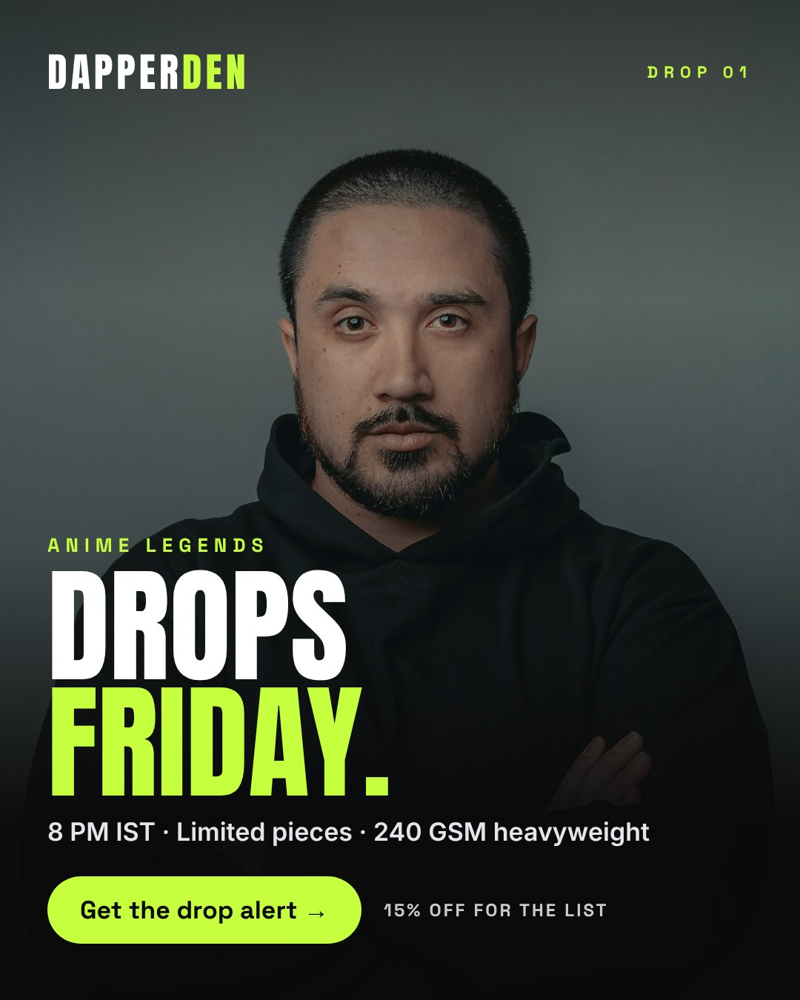
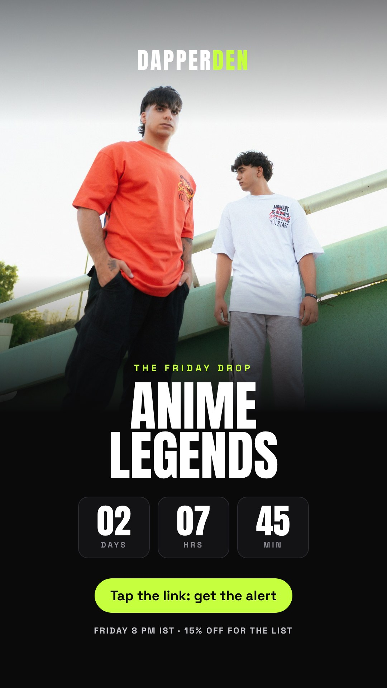
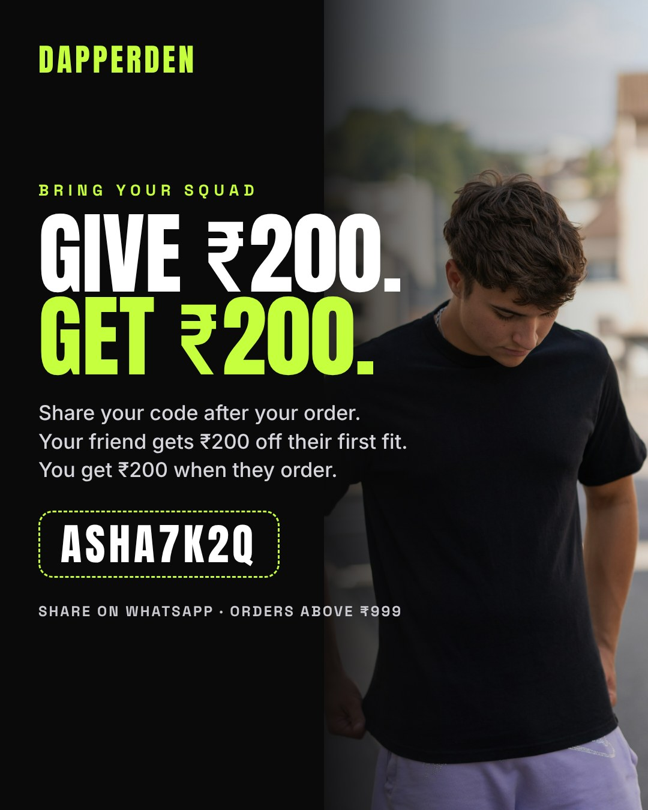

**The Friday Drop.** A launch campaign for the Anime Legends collection, built around a weekly ritual (*Drops Friday, 8 PM*) and an owned audience rather than one-off clicks. The plan covers the audience and insight, message pillars, offers, channel mix with creator seeding, a two-week calendar, a ₹1 lakh budget with funnel maths and an honest payback analysis, KPIs, tests and risks. The [drop page](https://dapper-denn.netlify.app/drop) is live: a countdown, a collection preview, and an email/WhatsApp sign-up with consent that records which channel each sign-up came from.

**Brand reels.** Four 20-second reels (*Drops Friday*, *Will it fit?*, *Pay your way* and *Give ₹200, get ₹200*) play on the homepage and are ready for Instagram and Facebook. They're cut to an original beat composed for the brand. [About the reels →](docs/marketing/reels.md)

**Retention flows, built into the store:**

| Flow | What it does |
|---|---|
| **₹50 off for paying online** | Shown at payment, with a nudge on the cash-on-delivery panel. Cash orders cost more and get refused more often |
| **Bag reminder** | One email 1 to 48 hours after a shopper leaves checkout, with a link that refills their bag on any device |
| **Give ₹200, get ₹200** | Every order gets a referral code and a WhatsApp share button. A friend's first order unlocks a one-time ₹200 code for the referrer |
| **"How did it fit?"** | Asked when an order is delivered. The answers become a "true to size" score on the product page once three buyers have answered |
| **Drop list** | Sign-up confirmation with a list-only code (EARLYDROP) |

## Every screen

| | |
|---|---|
| 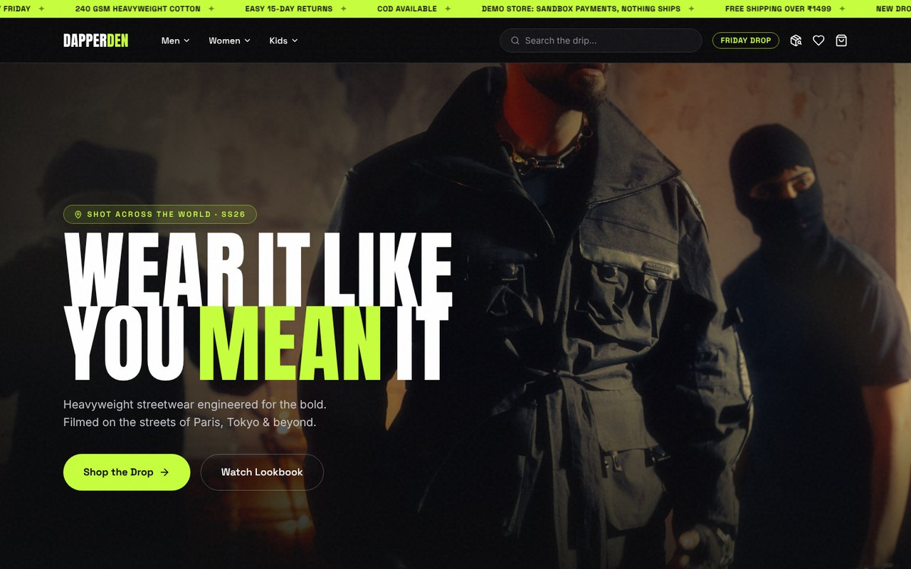 **The homepage.** The trust bar on top answers shipping, COD, returns and fabric before the shopper scrolls. | 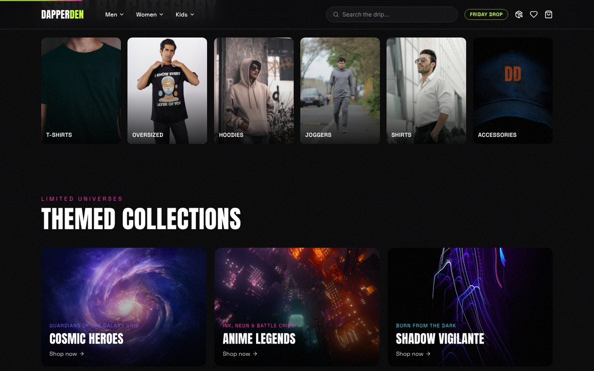 **Shop by fandom.** Six themed collections sit alongside the usual shop-by-category row. |
| 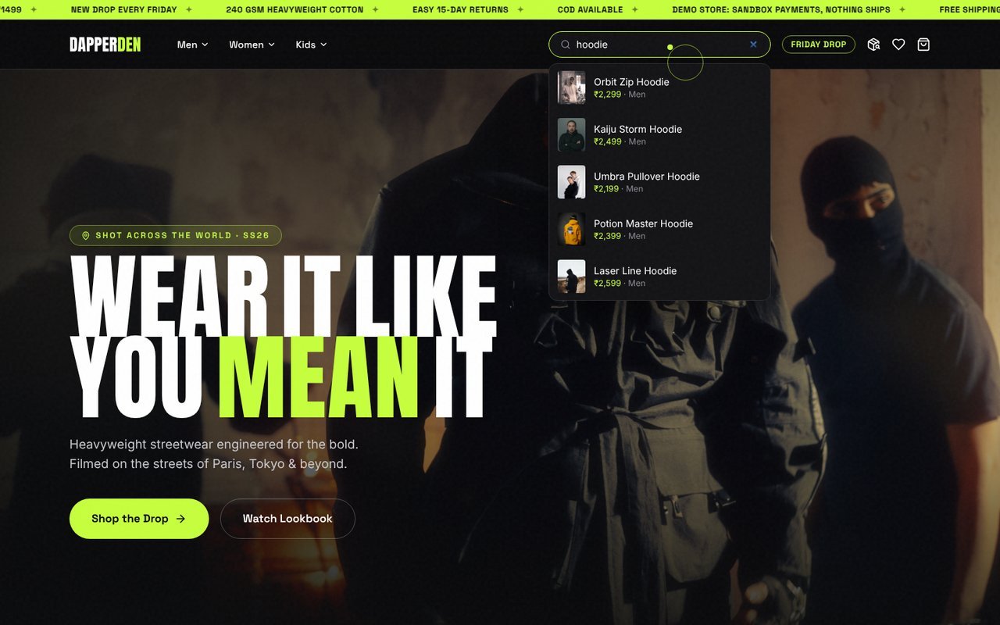 **Search that suggests.** Matching products, with price and photo, appear as you type. | 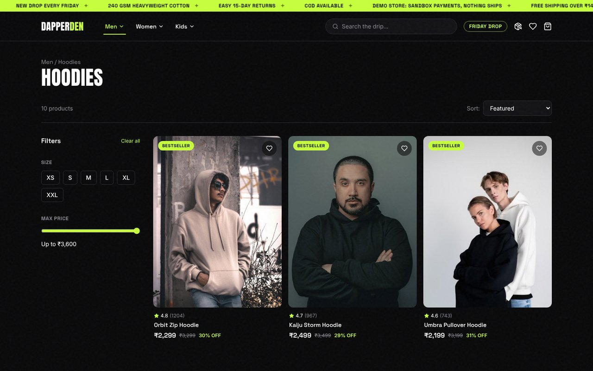 **Filters that matter for clothes.** Size and price filters, sorting, rating and Bestseller badges. |
| 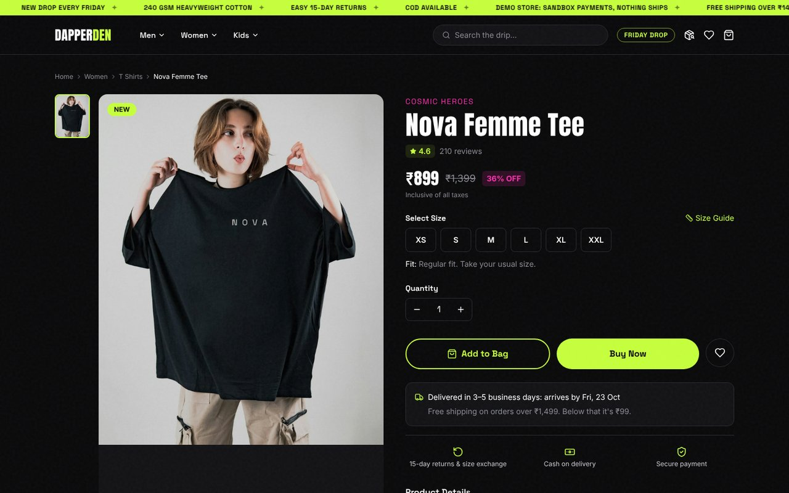 **The product page.** MRP and % off, rating, and the shipping, returns and payment promises next to the buy buttons. | 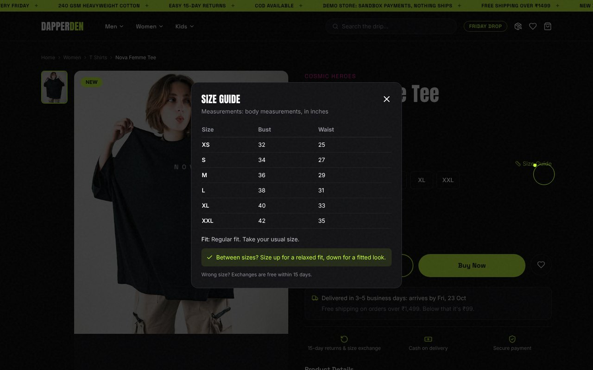 **The size guide.** Measurements by size, plus a fit tip, one tap from the size picker. |
| 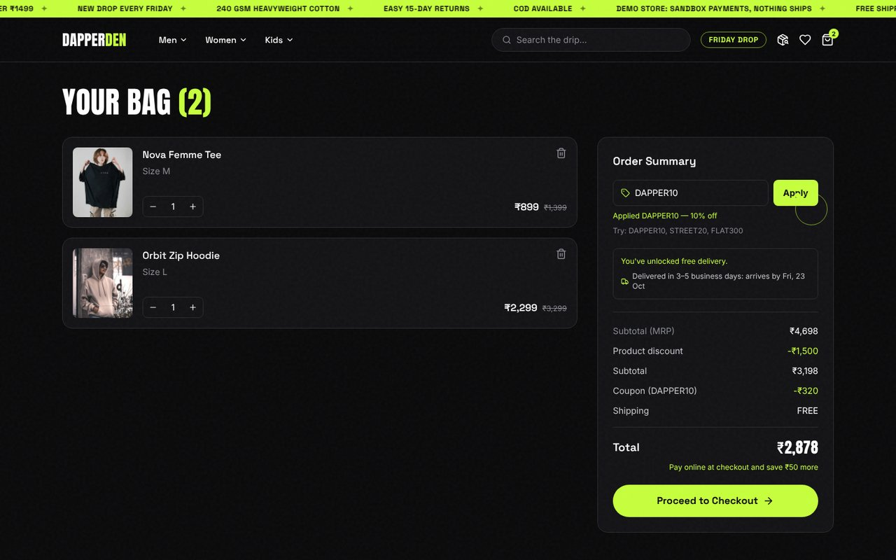 **The bag.** Coupon savings shown line by line, free shipping called out, and *Complete the look* cross-sell. | 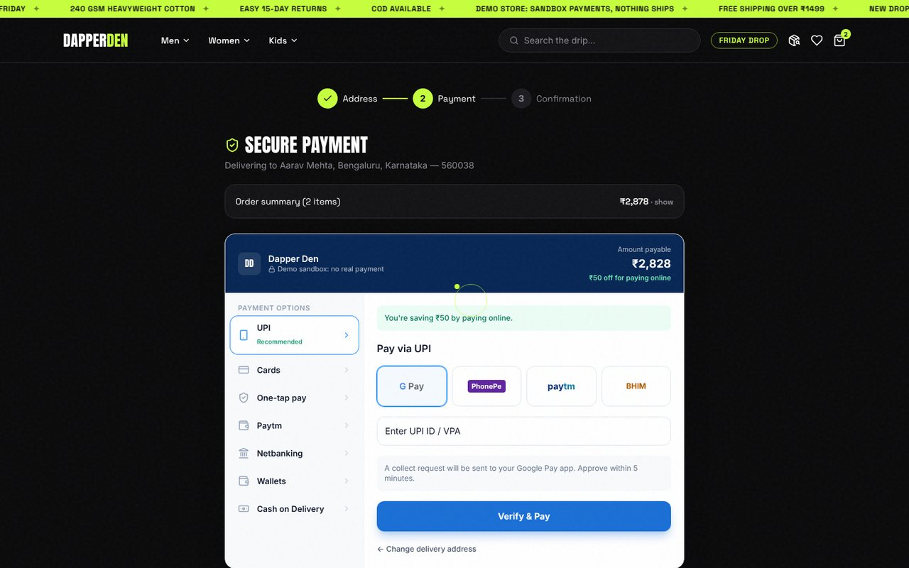 **UPI-first payment.** The method most Indian shoppers use is open by default; COD, EMI and the rest are one tap away. |
| 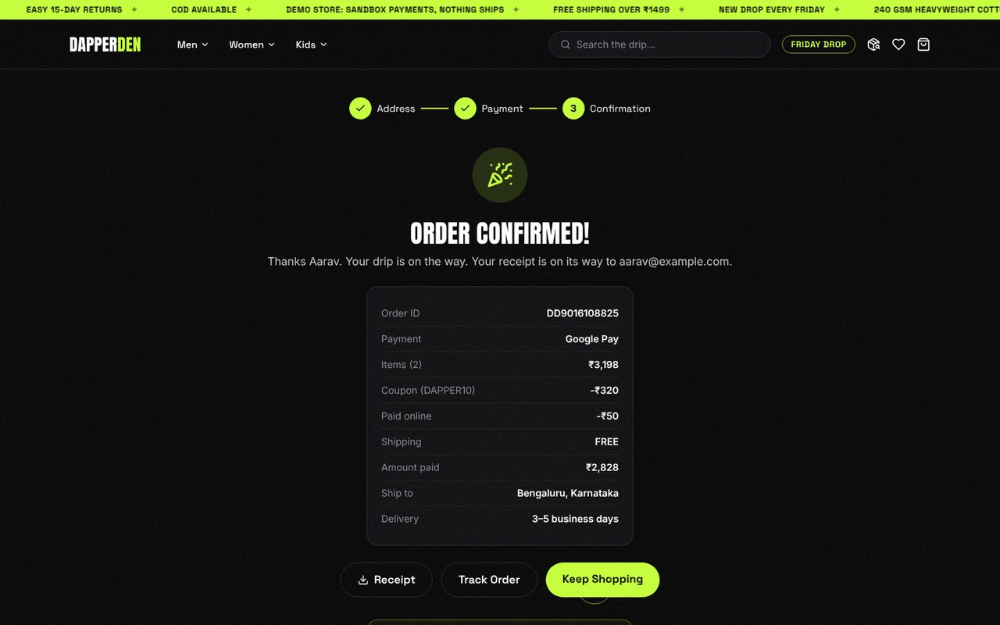 **Confirmation.** An itemised summary, a downloadable receipt and tracking, with no account needed. | 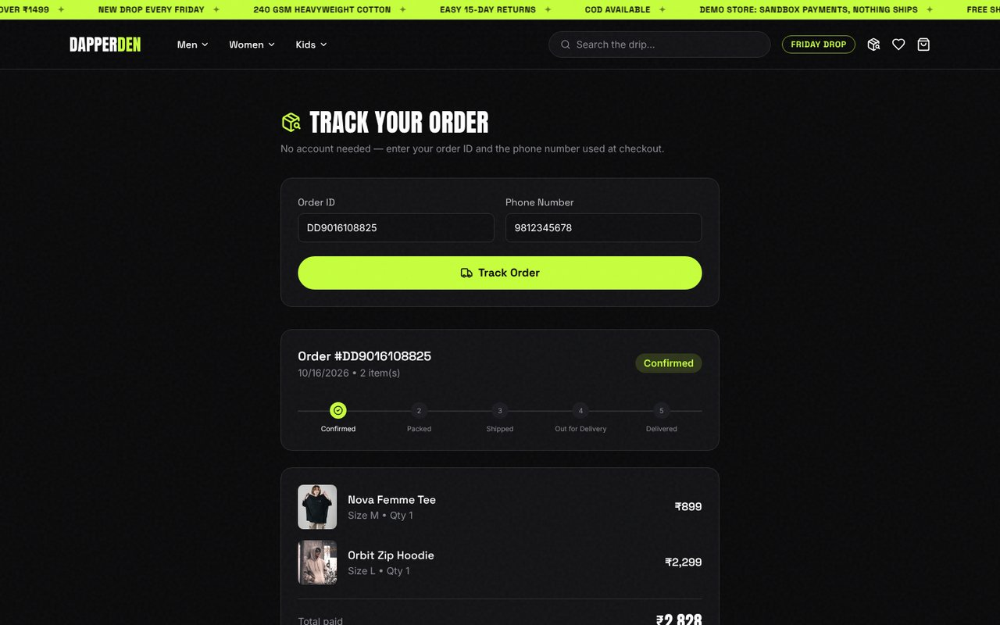 **Tracking.** Order ID and phone number are all it takes. Links in the emails open it already filled in. |
| 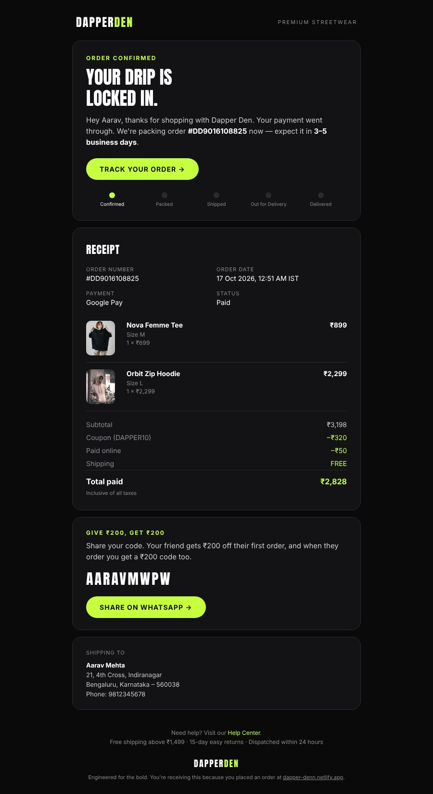 **The receipt email.** On-brand, itemised, with a track button, the delivery timeline and the returns promise. | 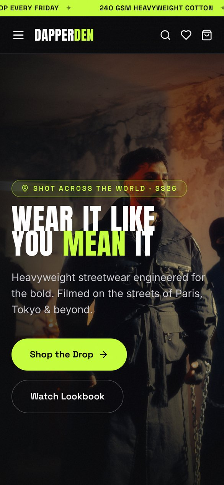 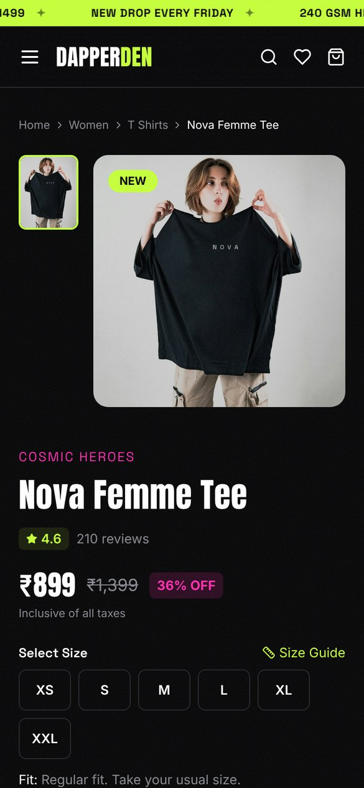 **On a phone.** Every screen is built phone-first, where this audience shops. |

## Who it's for

- **The fan shopper.** A college student or young professional in India who wants their fandom on a tee that feels premium, at ₹549 to ₹3,199. They usually shop on their phone and pay by UPI or cash on delivery. Often they've never bought from this brand before, so trust has to be earned on the page. Their job to be done: *"Find a piece I love, be sure it fits, and know I can send it back if it doesn't."*
- **The gift buyer and the family.** The Women and Kids ranges, the wishlist and the size guide serve shoppers buying for someone else, who can't try anything on.

## How I'd measure it

The store is the prototype. Measuring it needs real traffic and analytics events (GA4 or similar), which is the next step. These are the numbers I'd watch, and what each one tests:

- **Primary: visit-to-order conversion**, split by step: product view, add to bag, checkout start, order placed. This shows exactly where shoppers still drop off.
- **Cart abandonment rate.** It tests whether the up-front trust messages and the UPI-first checkout keep shoppers going.
- **Size-related return rate.** It tests whether the size guide reduces returns.
- **Average order value** around the ₹1,499 free-shipping threshold, and coupon redemption. They test whether the threshold and coupons lift basket size or only give margin away.
- **Payment-method mix** (UPI, COD, cards). COD orders cost more to fulfil and get refused more often, so the share of prepaid orders matters as much as the order count. The ₹50 prepaid nudge is the lever to test.
- **Growth loops:** drop-list sign-ups and cost per sign-up by channel, bag-reminder recovery rate, and the share of orders that come from a referral code. Targets are in the [campaign plan](docs/marketing/launch-campaign.md#8-measurement).

## What I know, and what I'm still assuming

I keep first-hand findings separate from guesses.

| Confirmed | Still to validate |
|---|---|
| The friction points above came from auditing a real store's visit-to-order journey. | How much each friction point actually costs in lost orders. That needs the original store's analytics. |
| The rebuilt journey works end to end on the live site: orders are saved, priced on the server, emailed and trackable. | Whether conversion actually improves. That needs an A/B test with real traffic. |
| Every promise (free shipping over ₹1,499, COD, 15-day returns) appears at the moment the shopper needs it. | Whether the size guide measurably reduces size-related returns. |
| Six automated persona walkthroughs on the live store (simulated shoppers driving a real browser on six devices) found 28 issues, including a phone menu that didn't open. 26 are fixed. [Read the report](docs/research/usability-test.md). | How real shoppers behave. The walkthroughs were simulated, so a five-person test with real shoppers is next. |
| | The right free-shipping threshold and coupon levels for margin. |
| | Whether shoppers browse more by fandom collection or by garment type. |

## My role

I audited the original store's journey, found the friction, and decided what to fix and in what order. I wrote the messaging and set the merchandising and promotions: the themed collections, badges, coupon ladder and free-shipping threshold. I designed the checkout and post-purchase experience, and directed the brand: the dark-and-lime look, the Anton type and the voice (*"Wear it like you mean it"*, *"Your drip is locked in"*).

I built the working store with AI coding tools, directing them from the audit rather than writing the code by hand. That is how one marketer can take a conversion problem to a shipped, working fix without an engineering team. The full engineering trail is in this repo for anyone who wants to check it.

## The marketing work

| Skill | Where it shows up in the store |
|---|---|
| **UX and conversion audit** | Mapped the visit-to-order journey of a real store and traced drop-offs to four kinds of friction |
| **Messaging and objection handling** | Trust bar, homepage promise strip and product-page reassurance answer shipping, COD, returns and fabric before checkout |
| **Merchandising** | Six fan-themed collections, Bestseller, New and Trending badges, MRP strike-through with % off, related products from the same collection |
| **Cross-sell and basket building** | *Complete the look* in the bag, plus the free-shipping threshold at ₹1,499 as an order-value nudge |
| **Pricing and promotions** | A coupon ladder: DAPPER10 (10% off), STREET20 (20% off) and FLAT300 (₹300 off over ₹1,499), validated on the server; no-cost EMI from ₹3,000; a ₹50 prepaid nudge to cut cash-on-delivery risk |
| **Campaign planning** | [The Friday Drop](docs/marketing/launch-campaign.md): audience insight, message pillars, offers, channel mix, creator seeding, calendar, budget with funnel maths and payback, KPIs and tests |
| **Content and creative** | Three launch creatives (a feed post, a countdown story, a referral post), a [drop landing page](https://dapper-denn.netlify.app/drop) with a live countdown, and [four brand reels](docs/marketing/reels.md) on the homepage, edited to an original soundtrack |
| **Referral marketing** | Give ₹200, get ₹200: a code on every order, WhatsApp sharing, automatic ₹200 rewards, first-order and self-use rules |
| **Checkout optimisation for India** | 3-step guest checkout, UPI first, then cards, EMI, netbanking, wallets and COD; Indian cities and states, prices in ₹ inclusive of taxes |
| **Lifecycle and CRM email** | A branded receipt, shipping updates at each stage, a one-time bag reminder, the referral reward, a post-delivery fit question, drop-list confirmation, and a new-order alert for the store owner |
| **Post-purchase trust and retention** | Order tracking without an account, a printable receipt, a wishlist, and a "true to size" score built from real buyers' answers |
| **Attribution** | UTM conventions per channel; the drop page records the source of every sign-up |
| **Brand identity** | Logo, dark-and-lime palette, Anton headlines and a confident streetwear voice, carried from the site into every email |
| **Usability testing** | [Persona walkthroughs on the live store](docs/research/usability-test.md) across phones, slow 3G and keyboard-only browsing: 28 issues traced to their cause, 26 fixed |
| **Measurement planning** | A funnel metric for each change, so every fix can be tested, not assumed |
| **Video storytelling** | A [narrated walkthrough](https://dapper-denn.netlify.app/walkthrough/) with chapters ([chapter list](WALKTHROUGH.md)), plus 30-second cuts for portfolio pages and LinkedIn |

Brand files: [`docs/brand`](docs/brand).

---

### For engineers

React 19, Tailwind and Framer Motion on Netlify; a FastAPI API with MongoDB Atlas on Render; Resend for email.

- **Orders are priced on the server.** The browser only sends what was picked, so a tampered cart can't change the price.
- **Checkout never fakes a success.** A failed order shows an error and keeps the bag; *Order confirmed* only appears once the order is saved.
- **Emails go out after the order is saved**, so a slow mail provider never delays checkout. All customer input is escaped.
- 28 offline API tests cover pricing, coupons, referrals, bag reminders, fit feedback, the drop list, tracking, receipts, emails, the admin endpoints and catalogue consistency. Frontend unit tests cover search.

Architecture, API, setup, tests and deployment are in **[TECHNICAL.md](TECHNICAL.md)**.
